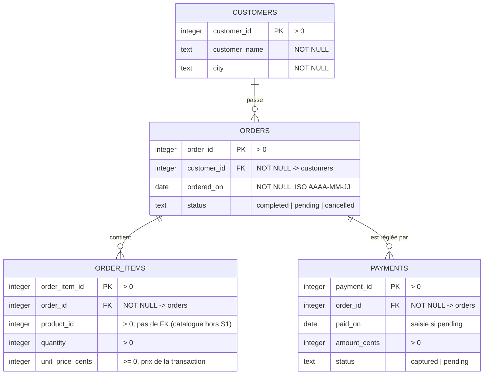
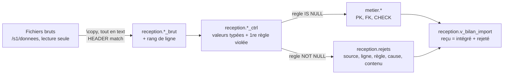

# M1 · Schéma relationnel annoté

## Grain des sources et relations

| Source | Grain | Clé | Volume reçu | Relation |
| --- | --- | --- | --- | --- |
| `customers.csv` | un client | `customer_id` | 180 | 1 client → 0..N commandes |
| `orders.csv` | une commande | `order_id` | 400 | 1 commande → 1..N lignes, 0..N paiements |
| `order_items.csv` | une ligne d'article | `order_item_id` | 802 | N lignes → 1 commande |
| `payments.ndjson` | une opération de paiement | `payment_id` | 480 | N paiements → 1 commande |

`order_items` et `payments` sont deux tables **enfants indépendantes** de `orders` : elles n'ont aucune relation directe entre elles. Les joindre sans agréger au préalable fabrique un produit cartésien par commande (voir [ANOMALIES.md](ANOMALIES.md), A5).

## Modèle métier (schéma `metier`)

Vues au grain commande (script `07_vues.sql`) : `v_commande_montant`, `v_commande_paiement`, `v_rapprochement` (une ligne par commande, contrôlé par C5).

## Chaîne d'import

**Ordre d'import** : `customers` → `orders` → `order_items` → `payments`. Chaque table enfant est contrôlée contre la table parente **déjà intégrée** : une commande rejetée rend ses lignes et paiements orphelins (R6), le rejet se propage et reste traçable.

**Règles de rejet** (une seule cause par ligne, la première violée) :

| Code | Règle | Traitement |
| --- | --- | --- |
| R0 | ligne NDJSON vide, JSON invalide ou qui n'est pas un objet | rejet |
| R1 | valeur obligatoire manquante (vide, `null`, clé absente) | rejet |
| R2 | type invalide : entier non convertible, date non ISO ou inexistante | rejet |
| R3 | hors domaine : identifiant ≤ 0, quantité ≤ 0, prix < 0, montant ≤ 0, statut inconnu (sensible à la casse) | rejet |
| R4 | doublon exact d'une ligne déjà reçue | 1re occurrence intégrée, suivantes rejetées |
| R5 | même identifiant reçu avec des contenus différents | toutes les occurrences rejetées |
| R6 | référence vers un parent absent ou rejeté | rejet |

Les règles ont été testées sur un jeu volontairement dégradé (une ou plusieurs lignes par règle, y compris la propagation client rejeté → commande orpheline) avant d'être appliquées aux fichiers fournis.

## Choix de conception justifiés

**1. Réception en `text` puis intégration contrôlée, plutôt qu'un `\copy` direct dans les tables contraintes.**
Un `\copy` dans `metier.order_items` échouerait en entier sur la ligne 802 (clé primaire en double) ou sur la ligne 803 (clé étrangère) : on perdrait les 800 lignes valides, et la cause n'apparaîtrait que dans un message d'erreur. Charger d'abord tout en `text` garantit que chaque ligne reçue est observable ; les règles R0–R6 décident ensuite, ligne par ligne, et `reception.rejets` conserve la cause et le contenu d'origine. Le bilan `reçu = intégré + rejeté` (contrôle C1) prouve qu'aucune ligne n'a disparu. Les fichiers bruts restent intacts (montage en lecture seule) et tout le script tourne dans une transaction : une erreur laisse la base dans son état précédent.

**2. Montants en `integer` de centimes et agrégation au grain commande avant tout rapprochement.**
Les sources sont en centimes : un `integer` les stocke exactement, sans erreur d'arrondi binaire (`real`/`double`) ni conversion à l'import. Les sommes sont calculées en `bigint` (`quantity::bigint * unit_price_cents`) et la conversion en euros n'intervient qu'à l'affichage. Comme `order_items` et `payments` ont chacune leur propre grain sous la commande, les vues `v_commande_montant` et `v_commande_paiement` les ramènent d'abord à une ligne par commande ; `v_rapprochement` ne joint ensuite que des grains identiques (1-1). Les contrôles C3 et C4 vérifient que les totaux des vues égalent les totaux des tables.

**Autres choix assumés**

- Pas de clé étrangère `order_items.product_id → products` : le catalogue est hors périmètre S1. Le code produit est seulement contrôlé comme entier positif.
- Statuts contrôlés par `CHECK (status IN (...))` plutôt qu'une table de référence : trois valeurs stables, documentées dans `SOURCES.md`.
- Pas de `UNIQUE (order_id, product_id)` : rien dans les sources n'interdit deux lignes du même produit à des prix différents. Le cas est surveillé (anomalies A9 : aucun).
- Un paiement capturé sur une commande annulée est **intégré** : c'est un fait enregistré par la source. Il est exclu du chiffre d'affaires et signalé (A7), pas effacé.
- Les index sur les clés étrangères sont laissés à la séance S3 pour comparer les plans avec et sans index.
